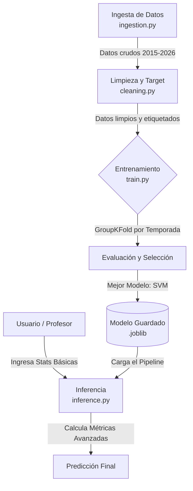

# 🏀 NBA Player Impact Classifier

Un sistema de *Machine Learning* de nivel de producción diseñado para predecir si un jugador de la NBA tendrá un impacto positivo en la cancha basándose **únicamente en métricas de eficiencia y ritmo**, evitando por completo el *Data Leakage*.

## 📌 Descripción del Proyecto

El objetivo de este proyecto es clasificar a los jugadores de la NBA como **"Buenos" (Impacto Positivo)** o **"Malos" (Rotación/Recambio)**. 

Para definir un jugador "Bueno", se estableció un umbral estricto de **BPM (Box Plus/Minus) >= +1.5**. Esto asegura que el modelo aprenda a identificar a verdaderos jugadores de impacto (titulares y estrellas) y no a jugadores marginales.

### 🛡️ Enfoque Anti-Data Leakage
Uno de los mayores desafíos en *Sports Analytics* es no hacer "trampa". Métricas compuestas como `PER`, `WS` o el propio `BPM` contienen la respuesta que intentamos predecir. Por lo tanto, **este modelo excluye estas variables** y se entrena exclusivamente con estadísticas de tasa (porcentajes y métricas normalizadas por posesión) como `ts_pct`, `ast_pct`, `usg_pct`, etc.

---

## 🏗️ Arquitectura y Flujo de Trabajo (Pipeline)

El proyecto está diseñado con una arquitectura modular, separando claramente la ingesta de datos, el preprocesamiento, el modelado y la inferencia. 



### Flujo paso a paso:
1. **Ingesta (`ingestion.py`):** Descarga y consolida los datos históricos de la NBA (2015-2026).
2. **Preprocesamiento (`cleaning.py`):** 
   - Filtra jugadores con menos de 20 partidos jugados.
   - Maneja duplicados de jugadores que cambiaron de equipo a mitad de temporada (`2TM`, `3TM`).
   - Construye la variable objetivo (`y = 1` si `BPM >= 1.5`).
   - Elimina métricas compuestas (Data Leakage).
3. **Modelado (`train.py`):** 
   - Aplica `StandardScaler` a las métricas numéricas y `OneHotEncoder` a la posición (`pos`).
   - Utiliza **`GroupKFold`** (agrupado por temporada) para evitar que el modelo haga trampa viendo el futuro.
   - Entrena y compara 6 algoritmos (SVM, Logística, Random Forest, etc.).
4. **Inferencia (`inference.py`):** Módulo interactivo de consola que traduce las estadísticas básicas del usuario (Puntos, Rebotes, Minutos) a métricas avanzadas y devuelve la clasificación.

---

## 📓 Notebooks de Análisis (EDA e Interpretabilidad)

La carpeta `notebooks/` contiene el análisis exploratorio y la justificación técnica del modelo. Estos notebooks documentan el "por qué" detrás de las decisiones del pipeline:

*   **`01_eda.ipynb` (Análisis Exploratorio de Datos):**
    *   Análisis univariado de las distribuciones (histogramas y boxplots).
    *   Análisis de correlación (matriz de Pearson) para detectar multicolinealidad entre variables.
    *   Estudio del balance del target y sesgo de las clases.
*   **`02_interpretabilidad_y_evaluacion.ipynb` (Resultados del Modelo):**
    *   Curva ROC y cálculo del AUC.
    *   Matriz de Confusión detallada (Trade-off entre Falsos Positivos y Falsos Negativos en el *scouting*).
    *   Importancia de las variables (Top Features) para entender qué métricas definen verdaderamente a un jugador de impacto.
    *   Comparativa de rendimiento entre validación histórica (CV) y prueba futura (Test 2026).

---

## 📂 Estructura del Repositorio

```text
nba_players/
├── configs/                  # Archivos de configuración del proyecto
├── data/                     # Datos crudos y procesados
├── models/                   # Pipeline entrenado listo para producción (.joblib)
├── notebooks/                # Jupyter Notebooks (EDA e Interpretabilidad)
│   ├── 01_eda.ipynb
│   └── 02_interpretabilidad.ipynb
├── src/
│   └── nba_classifier/
│       ├── data/
│       │   ├── ingestion.py  # Descarga de datos
│       │   └── scraper.py    # Scraping auxiliar
│       ├── preprocessing/
│       │   └── cleaning.py   # Limpieza, target y drop de leakage
│       ├── models/
│       │   └── train.py      # Entrenamiento y evaluación de modelos
│       └── inference.py      # Script CLI para predecir nuevos jugadores
├── tests/                    # Pruebas unitarias (pytest)
├── requirements.txt          # Dependencias del proyecto
└── README.md
```

## ⚙️ Instalación

1. Clona este repositorio:
   ```bash
   git clone https://github.com/tu-usuario/nba_players.git
   cd nba_players
   ```

2. Crea y activa un entorno virtual:
   ```bash
   python -m venv venv
   source venv/bin/activate  # En Windows: venv\Scripts\activate
   ```

3. Instala las dependencias:
   ```bash
   pip install -r requirements.txt
   ```

## 🎮 Uso

### 1. Entrenar el Modelo
Para descargar los datos, limpiar, construir el target y entrenar los modelos:
```bash
PYTHONPATH=src python -m nba_classifier.models.train
```
*El mejor modelo se guardará automáticamente en `models/classifier_pipeline.joblib`.*

### 2. Clasificar un Jugador (Inferencia)
Para usar el modelo entrenado e ingresar las estadísticas de un jugador:
```bash
PYTHONPATH=src python -m nba_classifier.inference
```
*El script te pedirá los datos por consola. Si no conoces alguna métrica, simplemente presiona `Enter` y usará el promedio histórico de la NBA para ese campo.*

## 📊 Resultados y Metodología

Se evaluaron múltiples algoritmos utilizando validación cruzada agrupada por temporada. El mejor rendimiento lo obtuvo la **Máquina de Vectores de Soporte (SVM)**.

| Modelo | CV Media (Pasado) | Test 2026 (Futuro Inédito) |
| :--- | :---: | :---: |
| **Support Vector Machine (SVM)** | **92.4%** | **90.0%** |
| Regresión Logística | 92.0% | 88.5% |
| Gradient Boosting | 91.4% | 88.9% |
| Random Forest | 90.8% | 88.7% |

**Métricas en Test (Temporada 2026):**
*   **Accuracy:** 90.0%
*   **Recall (Clase Buena):** 85% (El modelo detecta al 85% de los verdaderos jugadores de impacto).
*   **F1-Score (Clase Buena):** 0.79
*   **Diferencia CV vs Test:** Solo 2.4%. Esto demuestra una excelente capacidad de generalización sin sobreajuste (*overfitting*).

## 🔮 Trabajo Futuro
*   Implementar una interfaz web con **Streamlit** para visualización interactiva.
*   Incorporar datos de *Tracking* (velocidad, distancia recorrida) si estuvieran disponibles.
*   Probar modelos de *Ensemble* avanzados (XGBoost / LightGBM).

---
**Autor:** Poncho 
**Contexto:** Proyecto de Análitica y Visualización de Datos (AyVD).